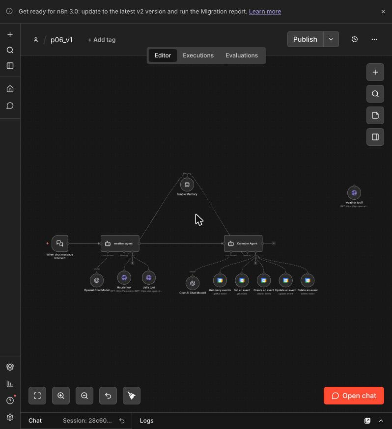

# 날씨를 보고 일정을 잡는 캘린더 에이전트

> 날씨를 보고 일정을 잡는 멀티 에이전트 캘린더 (n8n · Google Calendar · Open-Meteo)

**문제** — "다음 주 토요일에 야외 모임 잡아줘"는 두 가지 판단이 섞여 있다. 날짜 해석·날씨 확인과, 캘린더 조회·생성. v0에서 하나의 에이전트에 다 맡겼더니 날씨를 보지 않고 일정을 만들거나, 캘린더를 추측으로 답하는 일이 생겼다.

**흐름**

```
Chat Trigger
  └─ weather agent  ← 역할 1: 상대 날짜("이번 주 토요일")를 YYYY-MM-DD로 확정, Open-Meteo(hourly/daily)로 날씨 판단
       │             캘린더는 절대 건드리지 않음
       └─ Calender Agent  ← 역할 2: Google Calendar 도구(조회·생성·수정·삭제)로만 답변
                           툴 호출 없이 추측 답변 금지, 실패 시 실패했다고 말함
```

**설계 포인트 — 역할 분리**
- 에이전트를 둘로 나누고 각자 **하지 말 것**을 프롬프트에 명시했다: weather agent는 "일정 생성이나 캘린더 규칙은 절대 처리하지 않는다", Calender Agent는 "캘린더 요청은 추측하지 말고 반드시 툴 호출 결과로만 답한다".
- 일정 충돌 검사는 Calender Agent가 `Get many events`로 먼저 조회한 뒤 생성하도록 순서를 고정.
- 시간대는 두 에이전트 모두 `Asia/Seoul`로 고정 — 상대 날짜 해석이 어긋나는 가장 흔한 원인이었다.



## 사용

1. n8n → Workflows → Import from File → `workflows/06_weather_aware_calendar_agent.json`
2. 각 노드의 credential을 본인 계정으로 연결
3. placeholder 교체: `user@example.com`(캘린더 ID)

credential과 외부 ID는 모두 placeholder로 바꿔 두었습니다.

## 환경

n8n (self-hosted, Docker) · Google Calendar · Open-Meteo · OpenAI

---

다른 n8n 워크플로우와 규칙/AI를 나누는 기준은 [n8n-automation-workflows](https://github.com/sikumdev/n8n-automation-workflows)에 정리했습니다.
